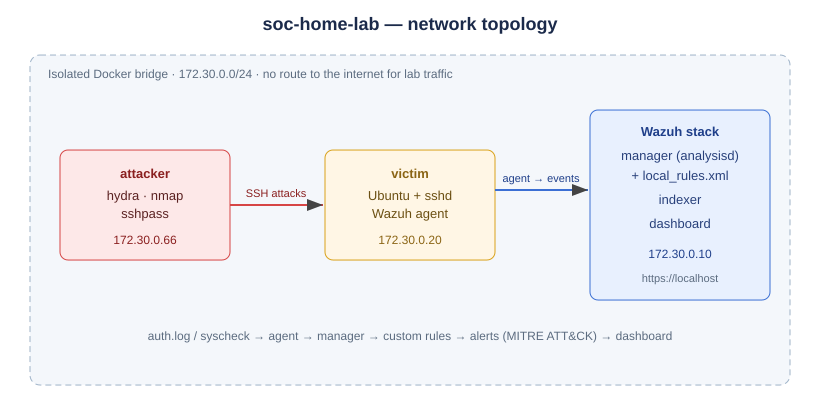

# soc-home-lab


A reproducible **SOC home lab** built on [Wazuh](https://wazuh.com). It stands up
a small monitored network in Docker, runs a scripted SSH attack chain against a
deliberately weak host, and detects every step with **custom rules mapped to
MITRE ATT&CK**.

> **This is a lab you can run, not a record of real incidents.** Everything here
> is synthetic: the "attacks" run only against this lab's own container, on an
> isolated network, using throwaway credentials. The attack scripts refuse to
> run against any target outside `172.30.0.0/24`. Use it on systems you own.

## What's inside

```
rules/local_rules.xml     14 custom detection rules, each mapped to MITRE ATT&CK
tests/                    replays test cases through the real Wazuh engine (CI)
lab/                      docker-compose overlay: victim + attacker + Wazuh wiring
attacks/                  scripted kill chain (recon → spray → brute → privesc → persistence)
scripts/                  setup.sh / attack.sh / teardown.sh
docs/                     network diagram + detection-rules reference + runbook
report/                   incident-report template to write up a lab run
examples/sample-alerts.json  real alert output captured from the engine
```

## Topology



- **wazuh.manager / indexer / dashboard** — the official single-node Wazuh stack.
- **victim** (`172.30.0.20`) — Ubuntu with sshd, a Wazuh agent, weak accounts and
  an over-permissive sudo rule. It is intentionally insecure.
- **attacker** (`172.30.0.66`) — Kali-style toolbox (hydra, nmap, sshpass).

## Requirements

- Docker + Docker Compose v2
- ~4 GB RAM free (the Wazuh indexer is the heavy part)
- Linux host with `vm.max_map_count=262144` (`sudo sysctl -w vm.max_map_count=262144`)

## Run it

```bash
# 1. Bring up Wazuh + the lab (clones the official wazuh-docker stack on first run)
scripts/setup.sh

# 2. Open the dashboard once it's healthy (2-3 min): https://localhost
#    login: admin / SecretPassword

# 3. Launch the attack chain and watch the alerts appear
scripts/attack.sh all          # or: recon | spray | brute | privesc | persist

# 4. Tear everything down
scripts/teardown.sh
```

Then open **Threat Hunting / Security Alerts** in the dashboard and filter on
rule groups `soc_lab` to see the detections, or write up the run with
[`report/incident-report-template.md`](report/incident-report-template.md).

## Detections

14 rules covering the chain. Full table with MITRE IDs and the test that proves
each one in [`docs/detection-rules.md`](docs/detection-rules.md). Highlights:

| Rule | MITRE | Detects |
|------|-------|---------|
| 100102 (level 14) | T1110 → T1078 | **successful SSH login right after a brute force** — the alert that matters most |
| 100100 | T1110.001 | SSH brute force from one source |
| 100101 | T1110.003 | password spraying / user enumeration |
| 100201 | T1548.003 | sudo → GTFOBins shell escape |
| 100300 | T1136.001 | UID 0 backdoor account |
| 100310 | T1098.004 | SSH key planted in `authorized_keys` (FIM) |
| 100400 | T1070.002 | auth log truncated to hide tracks |

## Testing

The rules are verified against the real Wazuh 4.12 engine — no mocks. Each case
in [`tests/cases.json`](tests/cases.json) is replayed through `wazuh-logtest`
inside a throwaway manager container, so frequency/timeframe correlation (brute
force, spraying, success-after-brute-force) is evaluated exactly as in
production.

```bash
./tests/test_rules.sh      # needs only Docker; this is what CI runs
```

Every push runs this via GitHub Actions. Current suite: **19/19 cases**, covering
both true positives and quiet-on-benign cases (a single failed login, a normal
sudo command and a normal UID account must *not* alert).

## Why this exists

A SOC analyst's core skill is turning telemetry into detections. This lab shows
the full loop end to end: build a monitored environment, generate adversary
behaviour, write detection logic, map it to ATT&CK, and prove it fires with
automated tests. It is meant to be read, run and extended.

## License

MIT — see [LICENSE](LICENSE).
